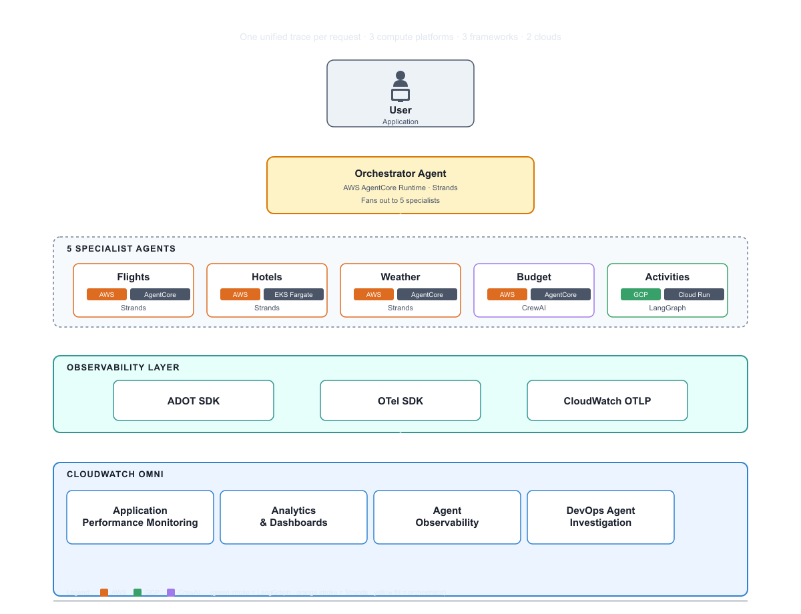

# Travel Concierge

A **multi-agent travel-concierge application** where agents are hosted
on **multi-cloud** (AWS and GCP), **multi-environment** (EKS Fargate,
AgentCore Runtime, Cloud Run), and **multi-framework** (Strands, CrewAI,
LangGraph). Every request produces a single OpenTelemetry trace stitched
across every cloud, every environment, every framework, and lands in
**CloudWatch Omni**.

> **This is sample code, for non-production usage.** You should work with
> your security and legal teams to meet your organizational security,
> regulatory, and compliance requirements before deployment.



## What's in here

- **4 agents on AgentCore Runtime** (`agents/`): orchestrator (Strands),
  flights, weather (Strands), budget (CrewAI). AWS Distro + the framework's
  native OTel tracer; shared FastAPI shell.
- **2 agents off AgentCore** (`remote-agents/`): hotels on AWS EKS Fargate
  behind a Cloudflare tunnel, activities on GCP Cloud Run.
- **Infra scripts** (`infra/`) that stand up / tear down the AgentCore
  side of the workload: IAM roles, DynamoDB tables, Lambda weather
  provider, 4 AgentCore Runtimes, 4 ECR repos.
- **Streamlit UI** (`frontend/app.py`) that invokes the orchestrator via
  `bedrock-agentcore:InvokeAgentRuntime`.
- **Fault scenarios** (`scripts/scenario.sh`) that trigger real AWS
  resource changes (not synthetic SSM flags) so Omni + the DevOps Agent
  investigate a real failure mode.
- **Docs** (`docs/`) covering architecture and telemetry ingestion.

See `docs/architecture.md` for the full system picture and
`docs/telemetry-ingestion.md` for how spans flow from agents into Omni.

## Required environment

Every infra command and the EKS deploy script read these:

| Variable          | Required | Example                 | Notes                                                      |
|-------------------|----------|-------------------------|------------------------------------------------------------|
| `AWS_PROFILE`     | yes      | `omni-demo`             | Profile used ONLY for the one-time bootstrap (`infra/setup.py` + `infra/seed_data.py` + `infra/deploy.py`). Use a dedicated IAM identity scoped to EXACTLY the following, per the AWS IAM best-practices [grant-least-privilege](https://docs.aws.amazon.com/IAM/latest/UserGuide/best-practices.html) guidance: `iam:*Role*`/`iam:*Policy*` on the `travel-concierge-*` role and policy ARNs; `lambda:*Function*` on `travel-concierge-weather-provider`; `dynamodb:*Table*` on `travel-concierge-flights` and `travel-concierge-hotels`; `ssm:PutParameter`/`GetParameter` on `/travel-concierge/*`; `ecr:*Repository*`, `ecr:GetAuthorizationToken`, `ecr:PushImage` on `travel-concierge-*` repos; `bedrock-agentcore:CreateAgentRuntime`/`UpdateAgentRuntime`/`GetAgentRuntime`/`ListAgentRuntimes` on this account; `sts:GetCallerIdentity`. **The deployed agents do NOT run as this profile**: each AgentCore runtime is attached at creation time to its own per-agent least-privilege IAM role created by `infra/setup.py`. Those per-agent roles are the authoritative least-privilege policies for ongoing operation; see `ROLE_FOR_AGENT` and the `POLICIES` dict in `infra/setup.py` for the exact statements. |
| `AWS_ACCOUNT_ID`  | yes      | `123456789012`          | Your 12-digit account id. Scripts fail loudly if unset.    |
| `AWS_REGION`      | no       | `us-east-1` (default)   | Primary region for every AWS resource.                     |

Export both before any `infra/*.py` call. The infra Python code resolves the
account id via `infra/_config.py`, which prefers `AWS_ACCOUNT_ID` and falls
back to `sts:GetCallerIdentity` on the active profile.

```bash
export AWS_PROFILE=omni-demo
export AWS_ACCOUNT_ID=$(aws sts get-caller-identity --query Account --output text)
export AWS_REGION=us-east-1
```

## Prerequisites

- `python >= 3.12`
- `aws` CLI configured with your profile
- `finch` or `docker` (ARM64 build support, for `agents/*/Dockerfile`)
- `gh` CLI (only if you fork this repo)
- `brew install gitleaks` if you plan to re-run the secret scan locally
- For `remote-agents/hotels-eks/`: `eksctl`, `kubectl`
- For `remote-agents/activities-{gcp,cloudrun}/`: `gcloud` + a GCP project
  with Cloud Run enabled

Install Python deps once per agent (each has its own `requirements.txt`), or
use the Phase B helper described below.

## Deploy to prod (AgentCore)

The infra scripts are idempotent. Run them in order:

```bash
# 1. SSM policies, DynamoDB tables, weather Lambda, 5 IAM roles.
AWS_PROFILE=omni-demo AWS_ACCOUNT_ID=$AWS_ACCOUNT_ID python3 infra/setup.py

# 2. Seed the DDB tables with mock flights/hotels inventory.
AWS_PROFILE=omni-demo AWS_ACCOUNT_ID=$AWS_ACCOUNT_ID python3 infra/seed_data.py

# 3. Build + push each agent's container, register as an AgentCore Runtime.
AWS_PROFILE=omni-demo AWS_ACCOUNT_ID=$AWS_ACCOUNT_ID python3 infra/deploy.py

# 4. Launch the Streamlit UI.
cd frontend && streamlit run app.py
# → http://localhost:8501
```

Optional remote specialists (replace the AgentCore flights pod with a
Kubernetes pod and an off-AWS activities pod):

```bash
AWS_PROFILE=omni-demo AWS_ACCOUNT_ID=$AWS_ACCOUNT_ID remote-agents/hotels-eks/deploy.sh
# For activities: see remote-agents/activities-cloudrun/README.md
```

## Run locally

Local F2 topology — every agent runs as a plain Python process on your
laptop; the orchestrator calls each specialist over plain HTTP; all 6
processes export OTel spans to the Omni local collector. Local and prod
produce the same trace tree, with one documented difference: the
orchestrator→specialist hop appears as an HTTP client span locally and
as a `bedrock-agentcore:InvokeAgentRuntime` SDK span in prod.

Topology:

```
  Omni Kiro extension — "Test Agent" / Playground
     │
     ▼ POST /invocations (HTTP, SSE)
  orchestrator :8080
     ├──▶ flights    :8081   (Strands)
     ├──▶ hotels     :8082   (Strands)
     ├──▶ weather    :8083   (Strands)
     ├──▶ budget     :8084   (CrewAI)
     └──▶ activities :8085   (LangGraph; same code as remote-agents/activities-cloudrun)
```

Streamlit is NOT part of the local stack — invoke the local orchestrator
from the Omni Kiro extension's Test Agent / Playground view against
`http://127.0.0.1:8080`. Streamlit only runs against prod — see the next
section.

Prereqs:

- Kiro IDE with the Omni extension running (so the local OTel collector
  is up and `OTEL_EXPORTER_OTLP_ENDPOINT` is exported in the Omni-managed
  terminal). The collector port is dynamic per Omni session; the dev-local
  script will source `.env.omni` from the adjacent workspace if the env
  var isn't already set.
- `AWS_PROFILE=omni-demo` (or any profile with read access to the demo
  account's DDB tables + weather Lambda).
- `AWS_ACCOUNT_ID=<your 12-digit id>` exported.
- A Python 3.12 venv activated.

Commands:

```bash
# one-time dep install into the active venv
scripts/dev-local-install.sh

# start 6 agents; prints PIDs, pings every /ping
AWS_PROFILE=omni-demo AWS_ACCOUNT_ID=$AWS_ACCOUNT_ID scripts/dev-local.sh

# Now invoke the orchestrator at http://127.0.0.1:8080 from the Omni Kiro
# extension's Test Agent / Playground view. Traces land in local mode
# Trace Explorer within seconds.

# Ctrl-C stops everything cleanly (SIGINT trap). Or:
scripts/dev-local-stop.sh
```

The script runs each agent under `opentelemetry-instrument uvicorn
main:app …`, exporting the same `OTEL_*` and content-capture env vars
`infra/deploy.py::_runtime_env` sets for prod — so spans line up with
prod on `service.name`, `cloud.*`, and `gen_ai.*` attributes.

The AgentCore prod path (`bedrock-agentcore:InvokeAgentRuntime`) remains
the DEFAULT behaviour of `agents/orchestrator/src/agent.py` and
`frontend/app.py`. Local mode is opt-in via `FLIGHTS_LOCAL_URL`,
`HOTELS_LOCAL_URL`, `WEATHER_LOCAL_URL`, `BUDGET_LOCAL_URL`,
`ACTIVITIES_LOCAL_URL` env vars — all set by `scripts/dev-local.sh`.

## Run the prod UI

Streamlit always points at prod AgentCore (via SSM/ARN). Use this to drive
the deployed system from a browser.

```bash
AWS_PROFILE=omni-demo ./scripts/streamlit-prod.sh
# → http://localhost:8501
#   custom port: ./scripts/streamlit-prod.sh --port 8502
```

The script explicitly unsets `ORCHESTRATOR_LOCAL_URL` so the frontend
takes the SSM/ARN path even if that env var is set elsewhere.

## Fault scenarios

Driven by `scripts/scenario.sh <A|B|D|E> <on|off|status>`. Each scenario
changes a REAL AWS resource (no synthetic flags) and snapshots the prior
state to `scripts/snapshots/` so `off` restores it bit-exact.

| Scenario | Resource change                                              | Observable failure                                              |
|----------|--------------------------------------------------------------|-----------------------------------------------------------------|
| **A**    | Attach `Deny` on `dynamodb:GetItem` to the flights IAM role. | Flights spans fault with `AccessDeniedException`.               |
| **B**    | Set the weather-provider Lambda's memory to 128 MB.          | AWS/Lambda `Duration` climbs; weather subtree widens.           |
| **D**    | Set `DDB_REGION=us-west-2` on the flights AgentCore runtime. | Flights `dynamodb:GetItem` fails with region-mismatch deny.     |
| **E**    | Flip `OTEL_INSTRUMENTATION_GENAI_CAPTURE_MESSAGE_CONTENT=false` on the hotels EKS pod. | Hotels chat spans arrive with no input/output content; other agents unaffected. |

Example:

```bash
AWS_PROFILE=omni-demo AWS_ACCOUNT_ID=$AWS_ACCOUNT_ID scripts/scenario.sh A on
# ... exercise Streamlit → observe fault in Omni, run DevOps Agent ...
AWS_PROFILE=omni-demo AWS_ACCOUNT_ID=$AWS_ACCOUNT_ID scripts/scenario.sh A off
```

## Docs

- [`docs/architecture.md`](docs/architecture.md) — full system walk-through,
  trace shape, AWS resource inventory
- [`docs/telemetry-ingestion.md`](docs/telemetry-ingestion.md) — per-agent
  OTel configuration, trace stitching, and GenAI content rendering

## License

MIT — see [LICENSE](LICENSE).
