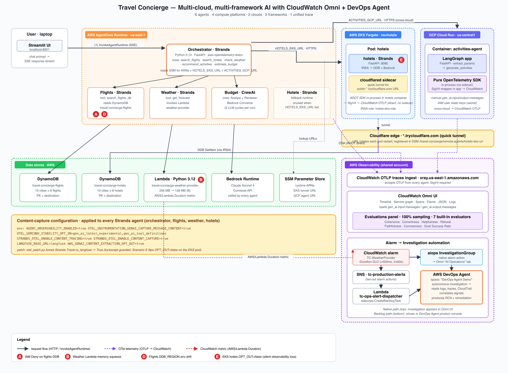

# Travel Concierge — End-to-End Architecture

A multi-agent travel-planning app for CloudWatch Omni and the AWS DevOps
Agent. An orchestrator fans out to five specialist agents hosted across
three compute environments (AgentCore Runtime, EKS Fargate, Cloud Run),
two clouds (AWS, GCP), and three frameworks (Strands, CrewAI, LangGraph),
producing one stitched OpenTelemetry trace per request.



> The diagram is authored as an SVG and rendered to PNG with
> `rsvg-convert -w 1800 architecture.svg -o architecture.png`. The SVG
> source is maintained in the internal copy of this repo.

---

## 1. At-a-glance

- **1 orchestrator** + **5 specialist agents** = 6 agents total
- **2 cloud providers**: AWS (5 agents) + GCP (1 agent)
- **3 agent compute environments**: AgentCore Runtime (4 agents) + EKS
  Fargate (1 agent) + Cloud Run (1 agent)
- **3 agent frameworks**: Strands, CrewAI, LangGraph
- **Backend data layer**: 1 Lambda (weather provider), 2 DynamoDB tables
  (flights, hotels), 1 Streamlit frontend
- **1 unified trace per request**, stitched end-to-end into CloudWatch
  (Transaction Search) / CloudWatch Omni via OTel W3C traceparent + AWS
  X-Ray trace header propagation
- **CloudWatch Omni** visualizes the trace tree + agent topology
- **AWS DevOps Agent** investigates incidents produced by three fault
  scenarios: IAM denial, Lambda memory squeeze, AgentCore env-var drift

AWS account: `<AWS_ACCOUNT_ID>`  |  Primary region: `us-east-1`
EKS cluster: `travel-concierge` (Fargate-only, Kubernetes 1.31)

---

## 2. Component inventory

| # | Component | Cloud | Hosting | Framework | Role in request |
|---|---|---|---|---|---|
| 1 | **Streamlit frontend** | local (user laptop) | `streamlit run app.py` | n/a | Collects user query, streams SSE events, renders agent answer. |
| 2 | **Orchestrator agent** | AWS | AgentCore Runtime | Strands 1.35 | Fans out to the 5 specialists, synthesises final answer. |
| 3 | **Flights specialist** | AWS | AgentCore Runtime | Strands 1.35 | Searches a DynamoDB-backed flight catalog, filters by budget + date window. |
| 4 | **Hotels specialist** | AWS | **EKS Fargate** (K8s `travel-concierge` / ns `hotels`) | Strands 1.35 | Searches a DynamoDB-backed hotel catalog, filters by nightly rate. Fronted by a Cloudflare Tunnel sidecar (`*.trycloudflare.com`) that gives the pod a reachable public URL — see §3.5. |
| 5 | **Weather specialist** | AWS | AgentCore Runtime | Strands 1.35 | Calls a season-aware Lambda to produce a 3-day forecast. |
| 6 | **Budget specialist** | AWS | AgentCore Runtime | **CrewAI 1.x** (2-agent crew: Analyst + Reviewer) | Picks lowest-reasonable combo from flights/hotels and sanity-checks the math. |
| 7 | **Activities specialist** | **GCP** | Cloud Run | **LangGraph 0.6+** (2-node graph: `extract_params` → `generate_activities`) | Suggests 3 activities for the destination; calls AWS Bedrock cross-cloud. |
| 8 | **Weather provider Lambda** | AWS | Lambda `travel-concierge-weather-provider` | Python 3.12 | Season-aware forecast generator. Invoked by weather specialist. |
| 9 | **Flights data store** | AWS | DynamoDB `travel-concierge-flights` | n/a | 10 destinations × 8 flights/each. PK=`destination` (lowercase city). |
| 10 | **Hotels data store** | AWS | DynamoDB `travel-concierge-hotels` | n/a | 10 destinations × 8 hotels/each. PK=`destination`. |
| 11 | **SSM Parameter Store** | AWS | `/travel-concierge/*` | n/a | Runtime ARN registry + weather Lambda URL + budget prompt variant + EKS hotels tunnel URL. |
| 12 | **Cloudflare Tunnel sidecar** | AWS | Sidecar container in the `hotels` pod | `cloudflare/cloudflared:latest` (quick tunnel) | Issues an outbound tunnel to Cloudflare's edge and gives the pod a public `https://*.trycloudflare.com` URL. See §3.5 for why this replaced ALB/NLB. |
| 13 | **CloudWatch Omni** | AWS | AWS-managed | n/a | Reads unified traces + agent topology + session data. |
| 14 | **AWS DevOps Agent** | AWS | AWS-managed | n/a | Investigation layer launched from an Omni "Investigate" button. |

### 2.1 IAM roles (one per agent, least-privilege)

| Role | Attached to | Grants |
|---|---|---|
| `travel-concierge-orchestrator-role` | Orchestrator runtime | Bedrock InvokeModel on Sonnet 4, `bedrock-agentcore:InvokeAgentRuntime` on the four specialist runtimes, SSM read on `/travel-concierge/*`, logs/xray write. |
| `travel-concierge-flights-role` | Flights runtime | Bedrock InvokeModel, DynamoDB GetItem on `travel-concierge-flights` (us-east-1 ARN), logs/xray write. |
| `travel-concierge-hotels-role` | (created by setup.py; no agent runtime attached) | DynamoDB GetItem on `travel-concierge-hotels`, Bedrock InvokeModel, logs/xray write. |
| `travel-concierge-hotels-eks-role` | **EKS hotels pod** (IRSA, bound to `hotels/hotels` ServiceAccount via OIDC) | DynamoDB GetItem on `travel-concierge-hotels`, Bedrock Converse, X-Ray `PutTraceSegments` / `PutSpans`. |
| `travel-concierge-weather-role` | Weather runtime | Bedrock InvokeModel, `lambda:InvokeFunction` on weather provider, logs/xray write. |
| `travel-concierge-budget-role` | Budget runtime | Bedrock InvokeModel, SSM read for prompt variant, logs/xray write. |
| `travel-concierge-weather-provider-role` | Weather Lambda | CloudWatch logs write only. |
| `travel-concierge-remote-gcp` (IAM **user**, not role) | GCP Cloud Run container | Bedrock InvokeModel + X-Ray `PutTraceSegments` / `PutSpans`. Static access keys injected as Cloud Run env secrets. |

### 2.2 SSM Parameter Store layout

| Parameter | Purpose |
|---|---|
| `/travel-concierge/runtime-arns/{orchestrator,flights,weather,budget}` | AgentCore runtime ARN registry. Looked up by the orchestrator at deploy to wire specialist tools, and by the Streamlit frontend to find the orchestrator. The hotels specialist runs on EKS Fargate — see `HOTELS_EKS_URL` below. |
| `/travel-concierge/weather-provider-url` | Weather Lambda Function URL (fallback path for the weather specialist). |
| `/travel-concierge/remote-agents/activities-gcp-url` | Cloud Run service URL for the activities specialist. Injected into the orchestrator at deploy time. |
| `/travel-concierge/remote-agents/hotels-eks-url` | Cloudflare Tunnel URL for the EKS hotels pod (e.g. `https://*.trycloudflare.com`). Injected into the orchestrator as `HOTELS_EKS_URL` at deploy time. Rotated on every pod restart because the quick-tunnel URL is ephemeral — see §3.5. |
| `/travel-concierge/policies/budget/prompt_variant` | `"stable"` or `"regressed"` — flips the Budget Analyst's backstory for the optional Scenario C prompt regression demo. |

---

## 3. Observability stack

Everything emits OpenTelemetry, but the collection path differs by compute
platform:

```
┌──────────────────────────────────────────────────────────────────────┐
│  AWS AgentCore Runtime (4 agents: orchestrator + flights + weather + │
│                        budget)                                       │
│                                                                      │
│  Container: python:3.13-slim                                         │
│  Entry: opentelemetry-instrument uvicorn main:app                    │
│         └─ aws-opentelemetry-distro 0.21.0-aws (auto-instrumentor)   │
│            ├─ FastAPI / botocore / requests / urllib3                │
│            ├─ Strands Agents / CrewAI                                │
│            └─ OTLPAwsSpanExporter → CloudWatch OTLP traces endpoint │
│               (same-account, same-region, SigV4 via runtime role)    │
└──────────────────────────────────────────────────────────────────────┘

┌──────────────────────────────────────────────────────────────────────┐
│  AWS EKS Fargate (1 agent: hotels)                                   │
│                                                                      │
│  Pod `hotels/hotels` with 2 containers:                              │
│                                                                      │
│  1) hotels (same image as the AgentCore version)                     │
│     Entry: opentelemetry-instrument uvicorn main:app                 │
│       └─ aws-opentelemetry-distro 0.21.0-aws (ADOT SDK, no Collector)│
│          └─ OTLPAwsSpanExporter → CloudWatch OTLP traces endpoint   │
│             (SigV4 via IRSA role; log-group headers route spans to  │
│              /aws/bedrock-agentcore/runtimes/travel_concierge_      │
│              hotels-eks so Omni's topology view groups them with    │
│              the AgentCore agents)                                   │
│                                                                      │
│  2) cloudflared sidecar (cloudflare/cloudflared:latest)              │
│     Entry: cloudflared tunnel --url http://localhost:8080            │
│       └─ Issues a quick tunnel (ephemeral URL on *.trycloudflare.com)│
│          and reverse-proxies inbound HTTPS to the hotels container.  │
└──────────────────────────────────────────────────────────────────────┘

┌──────────────────────────────────────────────────────────────────────┐
│  GCP Cloud Run (1 agent: activities)                                 │
│                                                                      │
│  Container: python:3.12-slim (no Collector sidecar)                  │
│  Entry: python3 /app/app.py                                          │
│    └─ otel_setup.py (vanilla OTel SDK + ~30-line SigV4 signer for   │
│                     the CloudWatch OTLP traces endpoint)             │
│       ├─ TracerProvider + BatchSpanProcessor                        │
│       ├─ OTLPSpanExporter → CloudWatch OTLP (SigV4 in-process)      │
│       ├─ CompositePropagator(W3C traceparent + AWS X-Ray)           │
│       ├─ FastAPIInstrumentor                                        │
│       ├─ BotocoreInstrumentor (auto-trace Bedrock Converse)         │
│       ├─ RequestsInstrumentor                                       │
│       └─ Manual spans on LangGraph nodes                            │
└──────────────────────────────────────────────────────────────────────┘
```

Both out-of-cluster paths (EKS and Cloud Run) ship OTLP in-process — no
Collector sidecar. Per AWS guidance in [AgentCore Observability](https://docs.aws.amazon.com/bedrock-agentcore/latest/devguide/observability-configure.html),
agents hosted outside AgentCore Runtime should use the **ADOT SDK** (not the
Collector) to send telemetry. The EKS pod uses `aws-opentelemetry-distro`'s
`OTLPAwsSpanExporter`, which SigV4-signs OTLP to the CloudWatch OTLP traces
endpoint using the pod's IRSA credentials. The Cloud Run container uses the
vanilla OpenTelemetry SDK plus a thin (~30 line) SigV4 signer on the
exporter, since the AWS Distro isn't available for the GCP IAM-user credential
chain. Both land spans in the same CloudWatch OTLP endpoint, keeping the
unified-trace shape without any extra container.

### 3.1 OTel environment variables (AgentCore agents)

Set per-runtime at register time by `infra/deploy.py::_runtime_env()`. On
AgentCore + ADOT, the runtime manages the full OTel wiring; a developer
sets a single content-capture flag.

| Env var | Value | Why |
|---|---|---|
| `AWS_GENAI_CONTENT_EXTRACTION_OPT_OUT` | `true` | **The only OTel variable you set.** Keeps prompt and response text on the span so Omni's trace detail panel and the online evaluators can read them. |
| `AGENT_NAME` | `orchestrator` / `flights` / `weather` / `budget` | App-level, used by `main.py` for FastAPI title + logger prefix. |
| `LOG_LEVEL` | `INFO` | App-level. |

AgentCore injects `AGENT_OBSERVABILITY_ENABLED=true`, `OTEL_PYTHON_DISTRO`,
`OTEL_PYTHON_CONFIGURATOR`, `OTEL_TRACES_EXPORTER`,
`OTEL_EXPORTER_OTLP_PROTOCOL`, `OTEL_EXPORTER_OTLP_ENDPOINT`,
`OTEL_RESOURCE_ATTRIBUTES`, `OTEL_PROPAGATORS`, and `AWS_REGION` on every
deployment. Per the AWS
[Send AI agent telemetry](https://docs.aws.amazon.com/AmazonCloudWatch/latest/monitoring/omni-send-ai-agent-telemetry.html)
guide, these managed defaults must not be duplicated in the runtime
resource. Frameworks with native OpenTelemetry tracing (Strands Agents
included) need no additional wiring.

Orchestrator-only additions (injected at deploy time by `infra/deploy.py`):

| Env var | Example | Purpose |
|---|---|---|
| `FLIGHTS_RUNTIME_ARN` | `arn:aws:bedrock-agentcore:us-east-1:...:runtime/travel_concierge_flights-72Yyav419R` | Wires the `search_flights` tool to the Flights specialist. |
| `HOTELS_EKS_URL` | `https://dec-amy-burning-supplemental.trycloudflare.com` | `search_hotels` tool target. The hotels specialist is EKS-only — the orchestrator reaches it over HTTPS via this URL. Rotated on every EKS pod restart because the Cloudflare quick-tunnel URL is ephemeral; a redeploy of `remote-agents/hotels-eks/deploy.sh` must be followed by `python3 infra/deploy.py --only orchestrator --skip-build` to refresh this env on the orchestrator. |
| `WEATHER_RUNTIME_ARN` | ... | `check_weather` tool target. |
| `BUDGET_RUNTIME_ARN` | ... | `estimate_budget` tool target. |
| `ACTIVITIES_GCP_URL` | `https://activities-agent-fheafkmf4a-uc.a.run.app` | `recommend_activities` tool target (cross-cloud HTTPS). |
| `TC_DISABLE_ACTIVITIES` | unset / `"true"` | If true, orchestrator skips registering the GCP tool for AWS-only testing. |

Weather-only additions:

| Env var | Purpose |
|---|---|
| `WEATHER_PROVIDER_FN` | Lambda name (`travel-concierge-weather-provider`). Primary call path. |
| `WEATHER_PROVIDER_URL` | Lambda Function URL. Fallback path if direct Lambda invoke permission is missing. |

Flights-only additions (used by Scenario D fault injection):

| Env var | Purpose |
|---|---|
| `DDB_REGION` | Optional override for the DynamoDB client region. Falls back to `AWS_REGION`. Scenario D flips this to `us-west-2` to simulate config drift. |

### 3.1.1 OTel environment variables (EKS hotels pod)

Set in `remote-agents/hotels-eks/manifests.yaml` on the `hotels` container.
Unlike AgentCore (which injects the OTel wire configuration for you), the
EKS pod declares every OTel env var itself — same `AWS_GENAI_CONTENT_EXTRACTION_OPT_OUT=true` content-capture
flag plus the full OTLP wire setup. The additional ones specific to the
EKS lane:

| Env var | Value | Why |
|---|---|---|
| `OTEL_EXPORTER_OTLP_PROTOCOL` | `http/protobuf` | Required by the AWS Distro's `OTLPAwsSpanExporter` (HTTP/protobuf; the default gRPC path is unused). |
| `OTEL_EXPORTER_OTLP_TRACES_HEADERS` | `x-aws-log-group=/aws/bedrock-agentcore/runtimes/travel_concierge_hotels-eks,x-aws-log-stream=spans` | Routes the pod's spans to the AgentCore log group naming convention so Omni's topology view groups them with the AgentCore agents. SigV4 signing + endpoint resolution handled in-process by the ADOT SDK using IRSA credentials. |
| `OTEL_LOGS_EXPORTER` | `none` | Pod stdout/stderr already flows to CloudWatch via the K8s runtime log collector; disabling the OTel log exporter prevents the Distro from retrying to export logs to a port that doesn't accept them. |
| `OTEL_METRICS_EXPORTER` | `none` | GenAI metrics are not enabled on this deployment. Disabling prevents the Distro from trying to export metrics; the CloudWatch OTLP traces endpoint rejects them, and metrics have a separate CloudWatch OTLP endpoint. |
| `OTEL_SERVICE_NAME` | `travel_concierge_hotels.eks` | Groups the EKS pod's spans distinctly from the AgentCore `travel_concierge_hotels.DEFAULT` runtime, so Omni's topology view shows them as two separate services. |
| `OTEL_RESOURCE_ATTRIBUTES` | `cloud.platform=aws_eks,service.framework=strands,deployment.environment=eks-fargate` | Topology grouping and filterability in Omni. |

### 3.2 Content capture

Strands (specialists, orchestrator) and CrewAI (budget) both ship with OTel
tracers that emit GenAI content natively when `AWS_GENAI_CONTENT_EXTRACTION_OPT_OUT=true`
is set (§3.1). Strands produces span **events** (`gen_ai.user.message`,
`gen_ai.assistant.message`, `gen_ai.tool.message`, `gen_ai.choice`); CrewAI
produces span **attributes** (`gen_ai.input.messages`, `gen_ai.output.messages`)
via the ADOT-bundled CrewAI instrumentor. Omni's trace detail panel reads
both forms interchangeably, so Input/Output renders identically for all
specialists. No helper modules, no `is_langfuse` monkey-patch, no
`OTEL_SEMCONV_STABILITY_OPT_IN` opt-in — the single env var is enough.

### 3.3 Trace propagation (how one request produces one trace)

Three propagators chained together make the trace stitch cleanly across every
hop:

1. **Streamlit → orchestrator**: boto3's `bedrock-agentcore:InvokeAgentRuntime`
   call carries an `X-Amzn-Trace-Id` header (AWS X-Ray format). AgentCore's
   auto-instrumentation reads it on the orchestrator side and continues the
   same trace.

2. **Orchestrator → AgentCore specialists**: same mechanism — orchestrator's
   three `InvokeAgentRuntime` calls (flights, weather, budget) each carry
   the parent trace context.

3. **Orchestrator → EKS hotels (cross-platform HTTPS)**: when
   `HOTELS_EKS_URL` is set, the orchestrator's `_invoke_remote_agent` helper
   issues a `requests.post` against the Cloudflare Tunnel URL instead of
   calling `InvokeAgentRuntime`. The composite propagator (installed below)
   attaches both W3C `traceparent` and AWS `X-Amzn-Trace-Id` headers. The
   EKS pod's `aws-opentelemetry-distro` reads either header on the inbound
   FastAPI span and continues the same trace. Spans flow back to the
   CloudWatch OTLP traces endpoint directly from the ADOT SDK in the pod
   (SigV4-signed in-process via IRSA), merging into the live trace.

4. **Orchestrator → GCP activities (cross-cloud HTTPS)**: identical to (3)
   except the target is Cloud Run. The GCP agent's `otel_setup.py` installs
   the same `CompositePropagator([TraceContextTextMapPropagator(),
   AwsXRayPropagator()])` so either header is accepted.

5. **GCP activities → AWS Bedrock**: boto3 inside the LangGraph node is
   auto-instrumented. Trace context is attached to the Bedrock `Converse`
   call. The resulting spans are then sent, via SigV4-signed OTLP, to the
   same CloudWatch OTLP traces endpoint — merging into the already-live trace.

### 3.4 Omni / CloudWatch traces content path

AWS Distro 0.21's LLO handler, if enabled, strips content attributes from
spans AT EXPORT TIME and routes them to CloudWatch Logs as Gen AI event logs
(correlated by `traceId`/`spanId`). Omni's trace viewer prefers content on
span attributes directly. With `AWS_GENAI_CONTENT_EXTRACTION_OPT_OUT=true`
the LLO handler is skipped and content stays on span attributes where Omni
expects it.

Important nuance: the **legacy `batch_get_traces` X-Ray API does not return
these attributes** even when they ARE present in the X-Ray backend. Omni UI
uses a richer data source. For debugging, trust Omni UI, not
`batch_get_traces`.

**Attribute size limits.** X-Ray caps total span attribute payload at
approximately 256 KB per span. Opting out of the LLO handler
(`AWS_GENAI_CONTENT_EXTRACTION_OPT_OUT=true`) keeps all GenAI content on
the span itself rather than extracting it to separate CloudWatch Logs
event records, which keeps Omni's trace detail panel populated. For
workloads with long RAG contexts or large tool schemas, this payload can
approach the per-span cap and X-Ray silently drops the over-cap spans.
Two mitigations are available:

- **(a) Truncate at the source.** Truncate `gen_ai.input.messages` /
  `gen_ai.output.messages` JSON payloads before setting the attribute.
- **(b) Re-enable the LLO extractor.** Set
  `AWS_GENAI_CONTENT_EXTRACTION_OPT_OUT=false` to move content back to log
  records; Omni will correlate them to the span by `traceId` / `spanId`.

### 3.5 EKS hotels pod exposure

The hotels pod is exposed to the orchestrator over the public internet
through a **`cloudflare/cloudflared` sidecar** running a Cloudflare quick
tunnel. The sidecar opens an outbound TLS connection to Cloudflare's edge
and registers a `*.trycloudflare.com` subdomain that reverse-proxies to
`localhost:8080` on the hotels container. Request flow:

1. Client issues HTTPS to `https://<random>.trycloudflare.com` (resolved
   by Cloudflare's anycast DNS).
2. Cloudflare edge forwards the request over the pre-existing tunnel to
   the sidecar.
3. Sidecar forwards to the hotels container on `localhost:8080`.

Quick tunnels are free. The URL is **ephemeral** — it changes on every
pod restart. `deploy.sh` extracts the URL from the sidecar logs and writes
it to SSM; the orchestrator reads it back from SSM on its next deploy, so
the handoff self-repairs after a restart as long as the orchestrator is
re-deployed afterward.

**Alternatives.** For a stable URL, replace the quick tunnel with a
Cloudflare named tunnel (`cloudflared tunnel create` plus a DNS CNAME) —
the sidecar config supports this, see
`remote-agents/hotels-eks/README.md`. A Service type `LoadBalancer` or an
ALB Ingress also works when the client network can resolve and reach
`*.us-east-1.elb.amazonaws.com`; some corporate and ISP networks filter
addresses in the `100.48.0.0/12` block that these endpoints resolve to,
in which case the tunnel is the simpler path.

---

## 4. Request flow — one user query, end-to-end

### Walkthrough: "Plan a trip to Austin Dec 22-28 2026, interests: live music, food trucks."

```
0. User types the query in Streamlit (http://localhost:8501).

1. Streamlit [frontend/app.py]:
      - Looks up /travel-concierge/runtime-arns/orchestrator in SSM
      - boto3 bedrock-agentcore invoke_agent_runtime(
            agentRuntimeArn=<orchestrator ARN>,
            runtimeSessionId=<session_id>, runtimeUserId=<user_id>,
            payload=JSON({"input":{"message":..., "session_id":..., "user_id":...}})
        )
      - Opens a streaming SSE response.

2. AgentCore Runtime routes to the orchestrator's container (us-east-1).

3. Orchestrator [agents/orchestrator/src/main.py]:
      - FastAPI /invocations handler reads the body
      - Calls agent.stream_async(message)
      - Strands Agent runs its event loop:
          Cycle 1 — initial plan:
             LLM call → model picks 5 tool calls to run
          Cycle 2 — tool execution:
             Fire 5 parallel tool calls:

             (3a) search_flights(destination, dates, max_price)
                   ↓ boto3 bedrock-agentcore:InvokeAgentRuntime
                   → Flights specialist container
                     ├─ Strands event loop (2 cycles)
                     ├─ Tool: search_flights_db(destination, max_price, departure_start, departure_end)
                     │        └─ boto3 dynamodb:GetItem (table=travel-concierge-flights)
                     └─ Second LLM cycle to summarise 2 best options
                   ← SSE: top 2 flights as JSON

             (3b) search_hotels(destination, dates, max_price_per_night)
                   ↓ requests.post(HOTELS_EKS_URL/invocations)
                     carries W3C traceparent + X-Amzn-Trace-Id
                     → Cloudflare edge
                       → `cloudflared` sidecar in the hotels pod
                         → hotels container (localhost:8080)
                           ├─ Strands event loop (2 cycles)
                           ├─ Tool: search_hotels_db
                           │        └─ dynamodb:GetItem (table=travel-concierge-hotels)
                           │           (IRSA credentials via STS AssumeRoleWithWebIdentity)
                           └─ Summarise 2 best options
                         Spans → ADOT SDK (OTLPAwsSpanExporter, in-process)
                                      → SigV4 → CloudWatch OTLP endpoint
                   ← SSE: top 2 hotels

             (3c) check_weather(destination, dates)
                   ↓ InvokeAgentRuntime → Weather specialist
                     ├─ Strands event loop
                     ├─ Tool: get_forecast
                     │        └─ lambda:Invoke travel-concierge-weather-provider
                     │              → Lambda runs season-aware forecast function
                     │              ← JSON {forecast, temp_range_f, chance_of_rain, packing_hints}
                     └─ Summarise forecast
                   ← SSE: 2-sentence weather summary

             (3d) recommend_activities(destination, dates, interests)
                   ↓ requests.post(ACTIVITIES_GCP_URL/invocations)
                     carries W3C traceparent + X-Amzn-Trace-Id
                     → GCP Cloud Run container (us-central1)
                       └─ FastAPI /invocations
                          └─ LangGraph graph.invoke:
                             ├─ node.extract_params (regex over user message)
                             └─ node.generate_activities
                                └─ cross-cloud boto3 bedrock:Converse
                                     (SigV4 using the travel-concierge-remote-gcp
                                      IAM user's static keys, pinned to us-east-1)
                     ← JSON {destination, dates, interests, activities (3 lines)}
                   ← HTTP 200

          Cycle 3 — synthesis:
             After 4 parallel tools return, orchestrator fires:

             (3e) estimate_budget(flights_json, hotels_json, days)
                   ↓ InvokeAgentRuntime → Budget specialist
                     └─ Crew.kickoff_async():
                        ├─ Task.execute (Analyst):
                        │    └─ Agent "Travel Budget Analyst":
                        │        └─ LiteLLM → bedrock:Converse
                        │           → "Pick: <airline> <id> for <price> USD + ..."
                        └─ Task.execute (Reviewer, context=analyst):
                             └─ Agent "Budget Reviewer":
                                 └─ bedrock:Converse
                                    → "Total: <total> USD within/over your budget."
                   ← SSE: Pick + Total two-liner

             Then one more LLM cycle to synthesise the final 5-line answer
             in the demanded format (Flight: / Hotel: / Weather: /
             Activities: / Total:).

4. Orchestrator streams SSE "text" events back to the frontend. Streamlit
   formats them (escapes $, inserts blank lines before section labels) and
   renders the final answer.

5. In parallel with (3)–(4), every span created above is batched by OTel
   SDK, exported via SigV4-signed OTLP to the CloudWatch OTLP traces
   endpoint. Omni reads them.
```

### 4.1 Resulting trace shape in Omni (observable)

```
POST /invocations                                   ← Streamlit → orchestrator
└─ invoke_agent Strands Agents  (orchestrator)
   ├─ execute_event_loop_cycle (plan)
   │   └─ chat                                      ← gen_ai span (LLM call)
   │       └─ chat us.anthropic.claude-sonnet-...   ← boto3 Bedrock subsegment
   ├─ execute_event_loop_cycle (tool execution — 5 tools fired)
   │   ├─ execute_tool search_flights
   │   │   └─ BedrockAgentCore.InvokeAgentRuntime   ← cross-runtime call
   │   │       (new trace subtree for flights specialist)
   │   ├─ execute_tool search_hotels
   │   │   └─ POST *.trycloudflare.com                 ← cross-platform HTTP
   │   │       (new trace subtree for hotels on EKS Fargate)
   │   ├─ execute_tool check_weather
   │   │   └─ BedrockAgentCore.InvokeAgentRuntime
   │   ├─ execute_tool recommend_activities
   │   │   └─ POST activities-agent-....run.app     ← cross-cloud HTTP
   │   │       (new trace subtree for GCP activities)
   │   └─ execute_tool estimate_budget
   │       └─ BedrockAgentCore.InvokeAgentRuntime
   │           (new trace subtree for budget)
   └─ execute_event_loop_cycle (synthesis)
       └─ chat
```

Each specialist's subtree carries its own `service.name` resource attribute
(`travel_concierge_flights.DEFAULT`, `travel_concierge_hotels.eks`,
`travel_concierge_activities.gcp`, etc.) so Omni's agent-topology view
groups spans by framework/cloud/compute-platform correctly. The hotels
subtree carries `cloud.platform=aws_eks` and `deployment.environment=
eks-fargate` resource attributes, visibly distinguishing it from the
AgentCore specialists in Omni.

Typical latency: 20-45 s end-to-end (model inference dominates). Cold Cloud
Run start adds 10-20 s to the first request of the day.

---

## 5. Fault scenarios (demo lane)

Scripts in `scripts/scenario.sh` toggle three real AWS resource changes that
drive natively-metered failures through the OTel trace. All three take a
snapshot of pre-change state before applying so `off` restores exactly what
was there.

| Scenario | Target | Mechanism | Fault signature in trace |
|---|---|---|---|
| **A** | Flights role | `aws iam put-role-policy` adds an explicit `Deny` on `dynamodb:GetItem` to `travel-concierge-flights-role` | `AccessDeniedException` on the flights DDB span. CloudTrail: `PutRolePolicy` with the Deny statement. |
| **B** | Weather Lambda | `aws lambda update-function-configuration --memory-size 128` | Elevated `AWS/Lambda.Duration`, `InitDuration` on cold starts. CloudTrail: `UpdateFunctionConfiguration`. |
| **D** | Flights AgentCore runtime | `UpdateAgentRuntime` sets `DDB_REGION=us-west-2` env var | `AccessDeniedException` on the flights DDB span, with a us-west-2 ARN in the error (deeper red herring — role is unchanged). CloudTrail: `UpdateAgentRuntime`. |

Each one has been validated end-to-end: fault captured in trace, DevOps
Agent can walk the audit trail and identify the root cause. See
`docs/trace-walkthrough.md` for the layer-by-layer Omni investigation path.

---

## 6. File map

```
travel-concierge/
├── agents/
│   ├── orchestrator/
│   │   ├── Dockerfile                 # python:3.13-slim + opentelemetry-instrument
│   │   ├── requirements.txt           # strands-agents>=1.22, aws-opentelemetry-distro>=0.10.1
│   │   └── src/
│   │       ├── main.py                # FastAPI /invocations + /ping, SSE streaming
│   │       └── agent.py               # Strands Agent + 5 tools (incl. cross-cloud)
│   ├── flights/   src/{main.py, agent.py}
│   ├── hotels/    src/{main.py, agent.py}  # same source powers the EKS deployment
│   ├── weather/   src/{main.py, agent.py}
│   └── budget/
│       └── src/
│           ├── main.py
│           ├── agent.py               # CrewAI 2-agent crew (Analyst + Reviewer)
│           └── policies.py            # Reads /travel-concierge/policies/budget/prompt_variant
├── remote-agents/
│   ├── activities-cloudrun/           # GCP Cloud Run (activities, LangGraph)
│   │   ├── Dockerfile                 # python:3.12-slim (no Collector sidecar)
│   │   ├── requirements.txt           # langgraph, opentelemetry-sdk + instrumentors, boto3
│   │   ├── app.py                     # LangGraph 2-node graph + manual gen_ai attrs
│   │   ├── otel_setup.py              # TracerProvider + SigV4Session + CompositePropagator
│   │   ├── deploy.sh                  # gcloud run deploy --source . with env + secrets
│   │   └── README.md
│   └── hotels-eks/                    # AWS EKS Fargate (hotels, Strands)
│       ├── cluster.yaml               # eksctl cluster spec (Fargate-only, OIDC, K8s 1.31)
│       ├── iam-policy.json            # IRSA role policy (DDB GetItem + Bedrock + X-Ray)
│       ├── manifests.yaml             # Namespace + SA + Deployment (2 containers: hotels + cloudflared)
│       ├── deploy.sh                  # Build hotels image + apply manifests + extract tunnel URL to SSM
│       ├── teardown.sh                # Delete namespace (keeps cluster for future re-use)
│       └── README.md                  # Cloudflare Tunnel rationale + stable-URL swap recipe
├── infra/
│   ├── _config.py                     # ACCOUNT_ID + REGION + feature flags
│   ├── _shared.py                     # Resource names, role names, boto session
│   ├── setup.py                       # Creates IAM roles, DDB tables, Lambda, SSM params
│   ├── seed_data.py                   # Loads 10 destinations × 8 options into DDB
│   ├── deploy.py                      # Builds ECR images, registers/updates AgentCore runtimes
│   ├── teardown.py                    # Full cleanup
│   └── ops-automation/                # DevOps Agent alarm → investigation Lambda
│       ├── lambda_handler.py
│       ├── deploy.sh
│       └── teardown.sh
├── scripts/
│   ├── dev-local-install.sh           # One-shot pip install for all 6 agents
│   ├── dev-local.sh                   # Start the 6-process local stack
│   ├── dev-local-stop.sh              # Stop the local stack
│   ├── streamlit-prod.sh              # Launch Streamlit against prod AgentCore
│   ├── scenario.sh                    # A/B/D fault injection toggles + snapshots
│   ├── get_fault_trace.sh             # Find a recent fault trace for DevOps Agent
│   └── snapshots/                     # Pre-change state captured by scenario.sh
├── frontend/
│   └── app.py                         # Streamlit chat UI, SSE drain, markdown sanitize
└── docs/
    ├── architecture.md                # (this file)
    ├── architecture.png / .svg        # The architecture diagram above
    ├── architecture-overview.png / .svg # Simplified overview for the README
    └── telemetry-ingestion.md / .png / .svg # Deep reference for the OTel ingestion path
```

---

## 7. Deployment summary

- Build + register all 4 AgentCore runtimes (orchestrator + flights, weather,
  budget). The hotels specialist is EKS-only and is deployed separately
  below:
  `AWS_PROFILE=omni-demo python3 infra/deploy.py`
- Create the EKS Fargate cluster (one-time, ~15 min):
  `AWS_PROFILE=omni-demo eksctl create cluster -f remote-agents/hotels-eks/cluster.yaml`
- Deploy the Hotels pod to EKS (builds the image, applies manifests, writes
  the Cloudflare Tunnel URL to SSM):
  `AWS_PROFILE=omni-demo ./remote-agents/hotels-eks/deploy.sh`
- Deploy the LangGraph agent to Cloud Run (writes URL to SSM):
  `./remote-agents/activities-cloudrun/deploy.sh`
- Re-run the orchestrator deploy so it picks up the latest EKS/GCP URLs from
  SSM (use `--only orchestrator --skip-build` to avoid a full rebuild):
  `AWS_PROFILE=omni-demo python3 infra/deploy.py --only orchestrator --skip-build`
- Launch frontend:
  `cd frontend && AWS_PROFILE=omni-demo streamlit run app.py --server.port 8501`
- Fault toggles: `./scripts/scenario.sh A on`, `./scripts/scenario.sh B on`, `./scripts/scenario.sh D on`.

Note: the Cloudflare quick-tunnel URL changes on every pod restart. If the
EKS pod is recycled (image push, node reclaim, manifest apply), re-run
`./remote-agents/hotels-eks/deploy.sh` followed by the orchestrator deploy
to repair the handoff. For a persistent URL use a Cloudflare named tunnel
instead — see `remote-agents/hotels-eks/README.md`.
